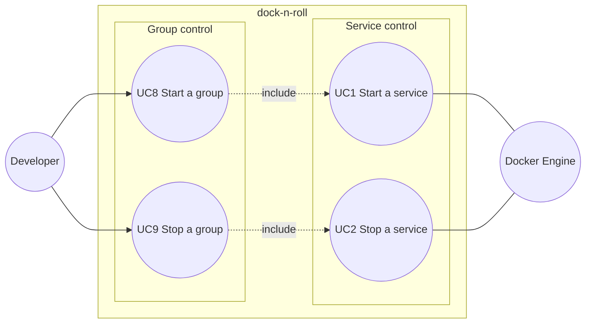

# Use case diagram — groups — start and stop a named set of services

> **Source specs**: issue #77, `docs/architecture/specs/v1-spec.md` §5 UC8 / UC9
> **Related ADRs**: none yet (owner MCDA 2026-10-24: storage B 450, semantics A 485)

## Context

A group (profile, e.g. "QA") names several Compose projects so the developer starts or stops
them in one action. Extends the launcher use cases (`../launcher/01-use-case.md`).

## Diagram

## Notes

- Membership is declared by hand in the pin file: `groups: [QA, demo]` on a `services[]` entry
  (MCDA B). Editing it is outside the app, like the rest of the pin file — not a use case.
- UC8 includes UC1 once per member that can start (off or partial, not pending); UC9 includes
  UC2 once per member that can stop. Members are run in parallel, best effort: one failure
  does not cancel the others, and each failure shows on its own row as today (MCDA A).
- A group with no member present in the list (all dirs missing) offers no action.
- #41 "stop all" is UC9 on the implicit group of every service; it reuses the same flow.
