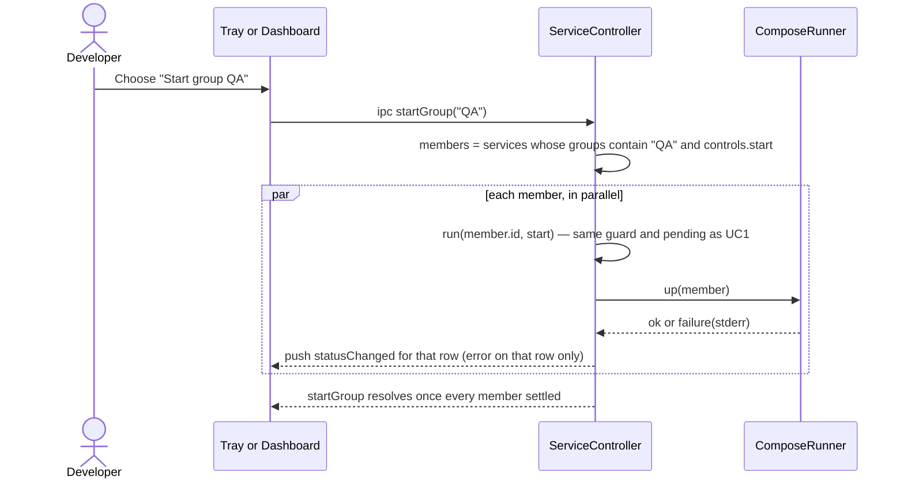

# Sequence diagram — groups — start a group

> **Source specs**: issue #77
> **Related diagrams**: `../launcher/02-sequence-start-service.md` (one member's start)

## Context

UC8 from the tray or the dashboard. Stop (UC9) is the same shape with `stop` and the stop
guard, and is not drawn.

## Diagram

## Notes

- No new state: the group action is a fan-out of the existing `run`, so the pending guard,
  health gate and error reporting stay per service (`Promise.allSettled`).
- Members already on or pending are skipped by the `controls.start` filter, so starting a
  half-running group only starts what is missing.
- Order is not guaranteed; ordering inside a project stays Compose's `depends_on`.
