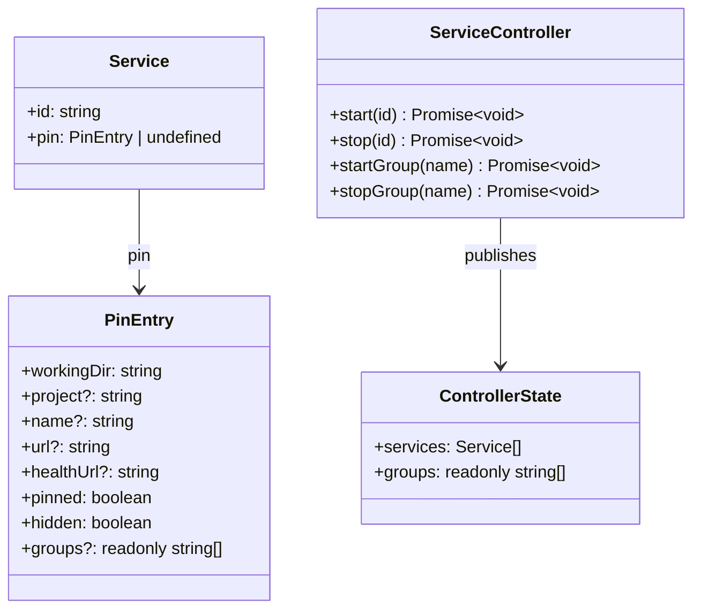

# Class diagram — groups — what changes in the domain and the controller

> **Related diagrams**: `../launcher/05-class-domain.md`, `../launcher/07-class-controller.md`

## Diagram

## Notes

- `groups` validation (`pin-file.ts`): a list of non-empty trimmed strings; anything else is
  reported in `errors` and the field ignored, like the other optional fields. Duplicates
  within one entry are dropped.
- `Service` already carries its `pin`, so membership is read from `service.pin.groups`: no
  copy on `Service`. Hidden services are not listed, so they are in no group.
- `ControllerState.groups` is the sorted, de-duplicated union of the members' groups; the UI
  shows group controls only when it is non-empty (progressive disclosure).
- UI: tray gets one "Groups" submenu with "Start all" / "Stop all" per group; dashboard gets one
  group menu in the header. Neither appears without a group.
