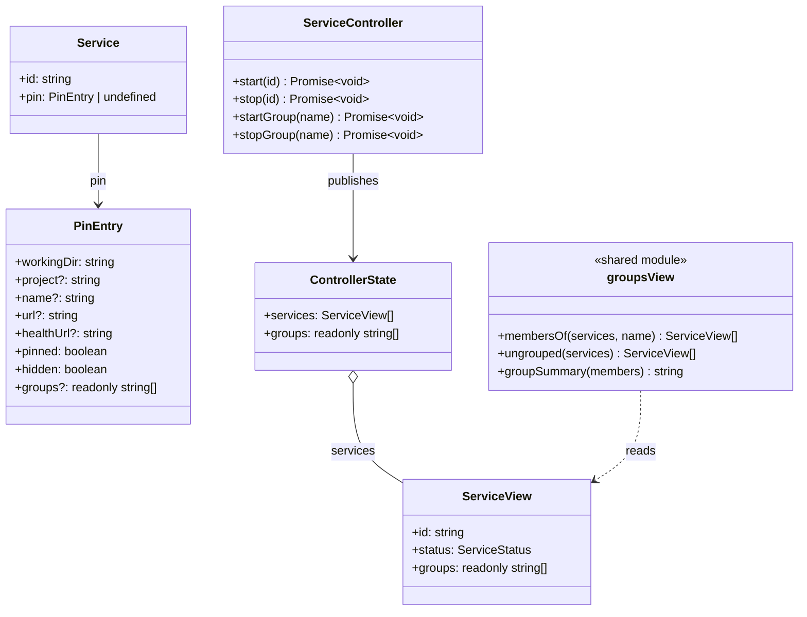

# Class diagram — groups — what changes in the domain and the controller

> **Related diagrams**: `../launcher/05-class-domain.md`, `../launcher/07-class-controller.md`

## Diagram

## Notes

- `groups` validation (`pin-file.ts`): a list of non-empty trimmed strings; anything else is
  reported in `errors` and the field ignored, like the other optional fields. Duplicates
  within one entry are dropped.
- `Service` already carries its `pin`, so membership is read from `service.pin.groups`: no
  copy on `Service`. Hidden services are not listed, so they are in no group.
- `ControllerState.groups` is the sorted, de-duplicated union of the members' groups; the UI
  shows group controls only when it is non-empty (progressive disclosure).
- `ServiceView.groups` copies `pin.groups` (empty without a group), so the tray and the
  dashboard group rows the same way (`src/shared/groups.ts`).
- UI (#98, owner MCDA A 480): the list itself is organised by group. Tray: one submenu per
  group, `<group> — <n> of <m> on`, holding Start all / Stop all then its members; ungrouped
  services follow, as before; the separate "Groups" submenu is gone. Dashboard: one collapsible
  section per group (summary line, Start all / Stop all, member rows), ungrouped rows after.
  A service in several groups is listed under each. Without a group both lists are unchanged.
