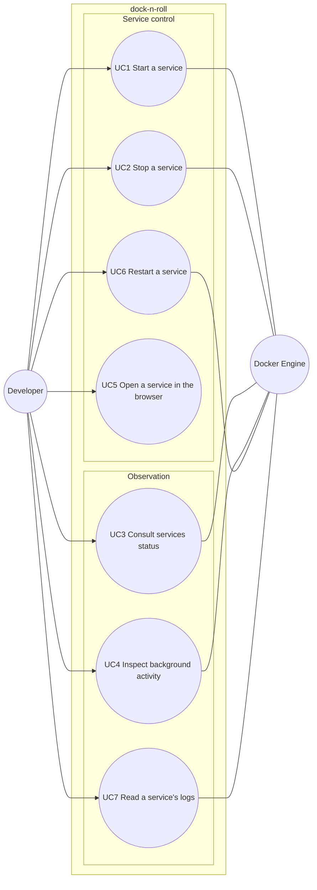

# Use case diagram — launcher — V1 goals of the developer

> **Source specs**: `docs/architecture/specs/v1-spec.md` §5
> **Related ADRs**: ADR-0002, ADR-0003

## Context

Who interacts with dock-n-roll V1, and to do what. Textual specs of each use case (steps,
extensions) live in the spec §5. Does not show where things run (see `03-component.md`).

## Diagram

## Notes

- Docker Engine is a **supporting** actor (secondary, linked without arrowhead): it never
  initiates a goal.
- "Being told a service became healthy" is not a use case — it is the success outcome of UC1.
- Editing the pin file is done by hand outside the app in V1 — not a use case of the system.
- UC6 (v1.1) restarts a running service so edits to its Compose file or `.env` apply: a
  stop then an `up`, see `12-sequence-restart-service.md`.
- Crash notifications (v1.1) are not a use case: they are UC3's extension 3b, the system
  telling the developer about a status change they did not ask for (`13-sequence-crash-notification.md`).
- UC7 (v1.1) follows the logs of one container of a service in a dashboard panel, see
  `14-sequence-service-logs.md`.
- Backlog goals (start a profile, clean exited containers) are deliberately absent.
