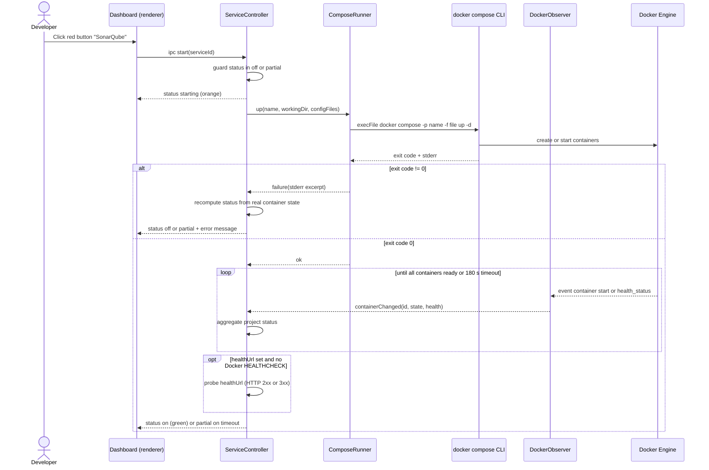

# Sequence diagram — launcher — start a service

> **Source specs**: `docs/architecture/specs/v1-spec.md` §5 UC1, §4
> **Related ADRs**: ADR-0002, ADR-0003

## Context

The only non-trivial flow of V1: it crosses the renderer, the main process, the Compose CLI
and the Docker Engine, and waits asynchronously for readiness. Stop (UC2) mirrors it without
the health wait and is not drawn.

## Diagram

## Notes

- `execFile` with an argument array — no shell, so no injection surface (spec R4).
- Readiness is driven by the Docker `/events` stream, not polling — the same path makes
  services started from a terminal update the UI (AC5).
- The guard prevents a double-click from spawning two `up` commands.
