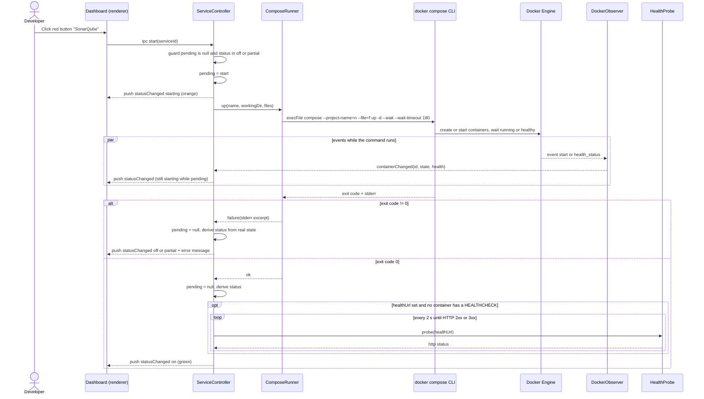

# Sequence diagram — launcher — start a service

> **Source specs**: `docs/architecture/specs/v1-spec.md` §3, §4, §5 UC1
> **Related ADRs**: ADR-0002, ADR-0003

## Context

The only non-trivial flow of V1: it crosses the renderer, the main process, the Compose CLI
and the Docker Engine, while Docker events keep arriving. Stop (UC2) is the same shape with
`stop`, no `--file` and no health gate, and is not drawn.

## Diagram

## Notes

- `execFile` with an argument array in `--flag=value` form — no shell, no flag injection
  (spec R4). A pinned service with no container yet runs without `--project-name` / `--file`.
- Readiness of containers is delegated to `compose up --wait`. The events channel is still
  what makes services started from a terminal update the UI (AC5).
- The guard is on `pending`, not on the displayed status, so a double-click or an event-driven
  `partial` cannot spawn a second `up`.
- The `healthUrl` gate is not specific to this flow: it also applies to a service started
  from a terminal (spec §3).
