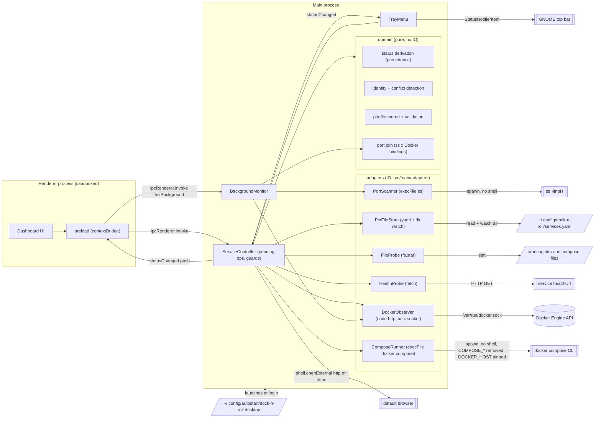

# Component diagram — launcher — V1 structure

> **Source specs**: `docs/architecture/specs/v1-spec.md` §3, §4, §6, §10
> **Related ADRs**: ADR-0001, ADR-0002, ADR-0003, ADR-0005

## Context

Structural boundaries of the Electron app and its egress points to the OS. Layering is
deliberately flat (personal tool): one pure `domain` module, thin adapters, no ports/interfaces
layer until a second implementation exists (shell services are backlog).

## Diagram

## Notes

- Dependency rule: `domain` imports nothing from Electron, Node IO or adapters — it is the
  unit-tested core. Adapters import domain **types** and pure mapping helpers only; the
  domain never imports an adapter (enforced by lint).
- Each adapter is a few functions over one OS boundary, written against its real interface
  (socket, child process, file system, HTTP). Their pure parts — mapping a Docker inspect to a
  `ContainerSnapshot`, parsing `ss` output, removing `COMPOSE_*` variables — live beside them
  and are unit-tested; the IO parts are integration-tested against stand-ins of the
  boundary (a fake Docker HTTP server on a temporary socket, a fake `docker` executable,
  temporary directories, a local HTTP server).
- `ComposeRunner` also resolves the real project name of a never-started pin with
  `docker compose --project-directory=<dir> config --format=json`, run in the project dir with
  remote includes disabled (spec §10 P1, ADR-0002).
- `PinFileStore` watches the **directory**, not the file: editors save by writing a new file
  and renaming it, which a file watch misses.
- The preload script runs in the renderer process, in an isolated context
  (`contextIsolation`, `sandbox`, no Node in the page). It exposes a narrow API:
  `listServices`, `start`, `stop`, `openUrl`, `listBackground`, `onStatusChanged`.
- ServiceController owns the pending operations and guards only. UC4 (background activity)
  goes through BackgroundMonitor, not through ServiceController.
- The Docker socket is the only root-equivalent egress (spec R4); nothing listens on the network.
