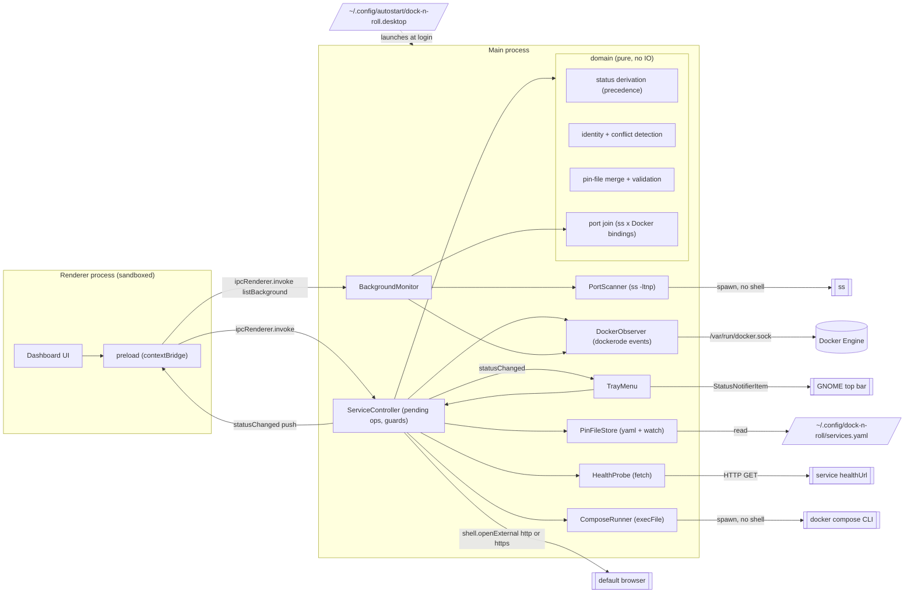

# Component diagram — launcher — V1 structure

> **Source specs**: `docs/architecture/specs/v1-spec.md` §3, §4, §6
> **Related ADRs**: ADR-0001, ADR-0002, ADR-0003

## Context

Structural boundaries of the Electron app and its egress points to the OS. Layering is
deliberately flat (personal tool): one pure `domain` module, thin adapters, no ports/interfaces
layer until a second implementation exists (shell services are backlog).

## Diagram

## Notes

- Dependency rule: `domain` imports nothing from Electron, dockerode or Node IO — it is the
  unit-tested core (status precedence of spec §4, conflict rule of ADR-0003, pin validation
  of R4/R6, port join of R3).
- The preload script runs in the renderer process, in an isolated context
  (`contextIsolation`, `sandbox`, no Node in the page). It exposes a narrow API:
  `listServices`, `start`, `stop`, `openUrl`, `listBackground`, `onStatusChanged`.
- ServiceController owns the pending operations and guards only. UC4 (background activity)
  goes through BackgroundMonitor, not through ServiceController.
- The Docker socket is the only root-equivalent egress (spec R4); nothing listens on the network.
