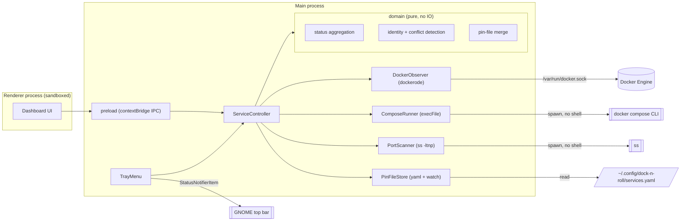

# Component diagram — launcher — V1 structure

> **Source specs**: `docs/architecture/specs/v1-spec.md` §3, §6
> **Related ADRs**: ADR-0001, ADR-0002, ADR-0003

## Context

Structural boundaries of the Electron app and its egress points to the OS. Layering is
deliberately flat (personal tool): one pure `domain` module, thin adapters, no ports/interfaces
layer until a second implementation exists (shell services are backlog).

## Diagram

## Notes

- Dependency rule: `domain` imports nothing from Electron, dockerode or Node IO — it is the
  unit-tested core (status table §4, conflict rule of ADR-0003).
- The renderer has no Node access (`contextIsolation`, `sandbox`); it only calls a narrow
  IPC API: `listServices`, `start`, `stop`, `openUrl`, `listBackground`.
- The Docker socket is the only root-equivalent egress (spec R4); nothing listens on the network.
