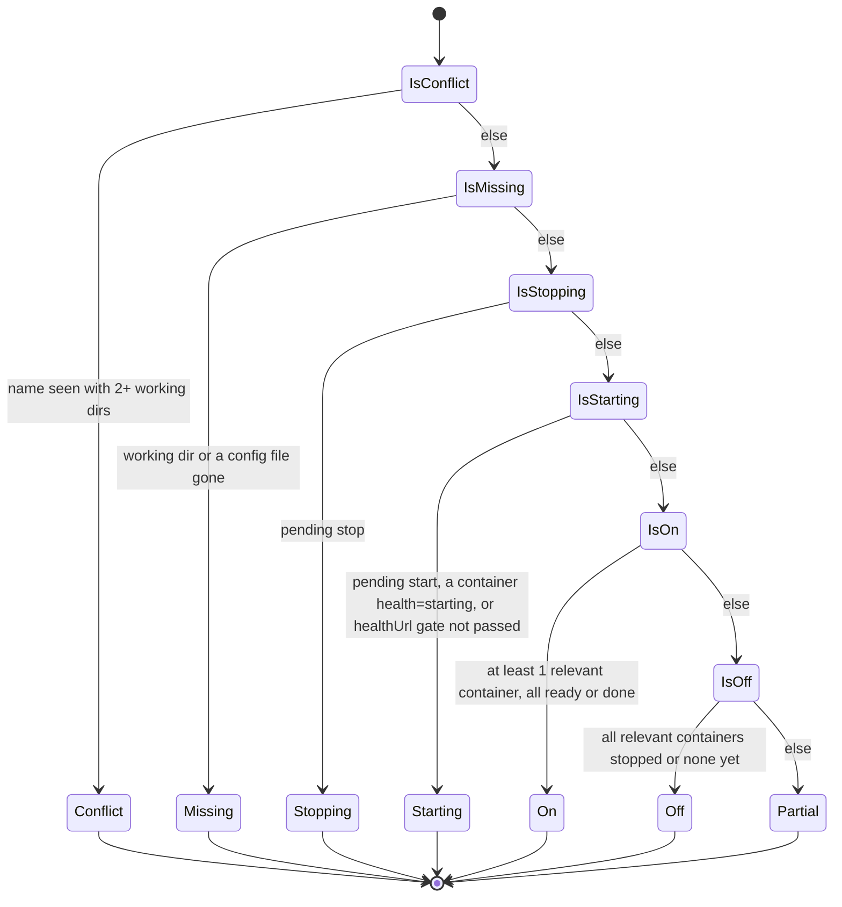

# State machine diagram — launcher — service status (derived)

> **Source specs**: `docs/architecture/specs/v1-spec.md` §3, §4
> **Related ADRs**: ADR-0002, ADR-0003

## Context

The status of a service is **derived**, not stored: a pure function recomputed on every
input change (container events, pending operation, path check, conflict check). This diagram
shows that derivation as a decision chain in precedence order. It replaces a hand-written
transition list, which cannot stay complete when Docker changes state on its own.
Colours: `on` green, `off` red, `starting` / `stopping` / `partial` orange, `missing` /
`conflict` grey.

## Diagram

## Notes

- One derivation per input change. Any status can follow any other, which is exactly why the
  status is derived: an event, a finished command or a deleted folder simply re-runs the chain.
- "Relevant", "ready" and "done" are defined in spec §3 (one-off containers ignored, exited-0
  jobs count as done, `healthUrl` gate).
- Which controls each status allows is in the spec §4 table (stop stays allowed in `missing`).
- Docker daemon unreachable is an **app-level** condition (banner, rows greyed without badge),
  not a service status.
