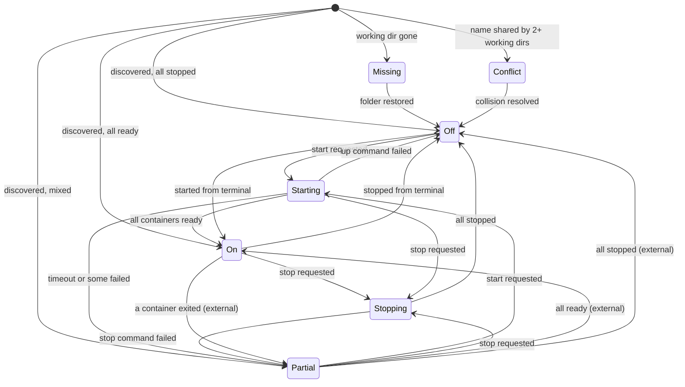

# State machine diagram — launcher — service status

> **Source specs**: `docs/architecture/specs/v1-spec.md` §4
> **Related ADRs**: ADR-0003

## Context

Lifecycle of the aggregated status of one service (Compose project). Colours: `on` green,
`off` red, transitional and `partial` orange, `missing` / `conflict` grey.

## Diagram

## Notes

- "external" transitions come from Docker events, not from the app — the state reflects
  reality, the app never assumes success.
- `Missing` and `Conflict` have no outgoing user-triggered transition: controls are disabled.
- Docker daemon unreachable is an **app-level** condition (banner), not a service state.
