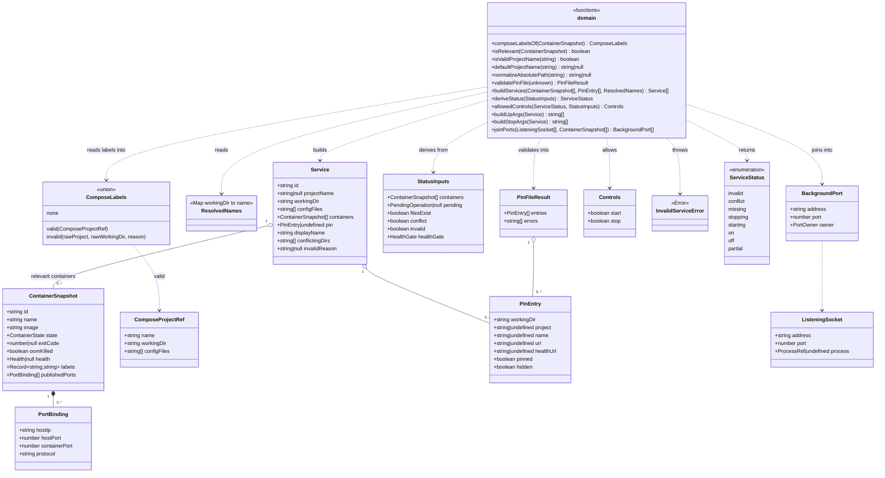

# Class diagram — launcher — pure domain types and functions

> **Source specs**: `docs/architecture/specs/v1-spec.md` §3, §4, §6, §8
> **Related ADRs**: ADR-0002, ADR-0003

## Context

Types and pure functions of `src/main/domain` (component `domain` in `03-component.md`).
Everything here is data in, data out: no Electron, no Docker client, no Node IO. Adapters
(`src/main/adapters`) translate Docker / `ss` / YAML into these input types; ServiceController feeds
them back in on every change. Does not cover adapters, IPC or UI.

## Diagram

## Notes

- Literal unions, not classes: `ContainerState` = Docker `State.Status`
  (`created | running | paused | restarting | removing | exited | dead`); `Health` =
  `starting | healthy | unhealthy`; `PendingOperation` = `start | stop`;
  `HealthGate` = `none | waiting | passed` (spec §3: `healthUrl` gate only when no running
  container has a `HEALTHCHECK`); `PortOwner` = `process(name, pid) | container(name) | unknown`.
- **`Service.id`** = `workingDir` + `\0` + project name; `workingDir` alone only for a
  never-started pin with no `project` key (spec §3). That id changes when the first container
  appears, so pending operations are keyed by `workingDir` + project name, not by id.
- **`conflictingDirs`** is non-empty iff the project name is used by ≥ 2 discovered working
  dirs (ADR-0003); an `invalid` project with a valid name still holds that name, but its own
  row shows `invalid`, never `conflict`. A never-started pin is flagged when a discovered project in another dir
  already uses the name it would start with — its `project`, or the name Compose derives from
  its dir (`defaultProjectName`). Only the pin is flagged: it never blocks the running
  project, and two never-started pins never flag each other.
- **`ComposeLabels`** = `none` (not a Compose container) | `valid(ComposeProjectRef)` |
  `invalid(rawProject, rawWorkingDir, reason)` (spec §10 P2). Invalid containers are grouped
  by their raw labels like valid ones; a project with ≥ 1 invalid container gets a non-null
  `invalidReason` and status `invalid` — it never disappears.
- **`ResolvedNames`** = map `workingDir → project name` produced by the adapter from
  `docker compose config` for never-started pins without `project` (spec §10 P1); the conflict
  check uses `pin.project ?? resolvedNames.get(dir) ?? defaultProjectName(dir)`.
- **Validation (spec R4)**: project names follow Compose's rule `^[a-z0-9][a-z0-9_-]*$`;
  paths are absolute, NUL-free and normalized (`/home/x/` matches the label `/home/x`). Labels
  failing these checks make the container `invalid` (see `ComposeLabels`); an invalid pin `project` drops
  the whole entry rather than widening it to the dir; duplicate pins are rejected.
- **`deriveStatus`** implements the spec §4 precedence, `on` requiring ≥ 1 relevant
  container; health is read on running containers only; the `healthUrl` gate holds a stack
  whose containers all run or are done. `allowedControls` implements the §4 Start / Stop
  columns (Start disabled while a container is `restarting` or `removing`).
- **`filesExist`** is computed by the adapter (path check is IO) and passed in, keeping
  `deriveStatus` pure.
- **`buildUpArgs` / `buildStopArgs`** produce the R4 argument arrays (`--flag=value` only,
  `--project-directory=<workingDir>`, one `--file=` per config file) and throw
  `InvalidServiceError` on an invalid name or path; for a pin with a `project` key and no
  container, `--project-name=<project>` is passed.
- **`joinPorts`** merges the IPv4 / IPv6 **wildcard** sockets of one port (observed on
  `sonarqube`: `0.0.0.0:9000` and `[::]:9000`), keeping the best-known owner (process >
  container > unknown). A container is credited only for a TCP binding on a compatible address.
  The caller passes TCP sockets only.
- Parsing `ss` text and Docker API objects stays in the adapters; the domain only sees the
  typed snapshots above.
