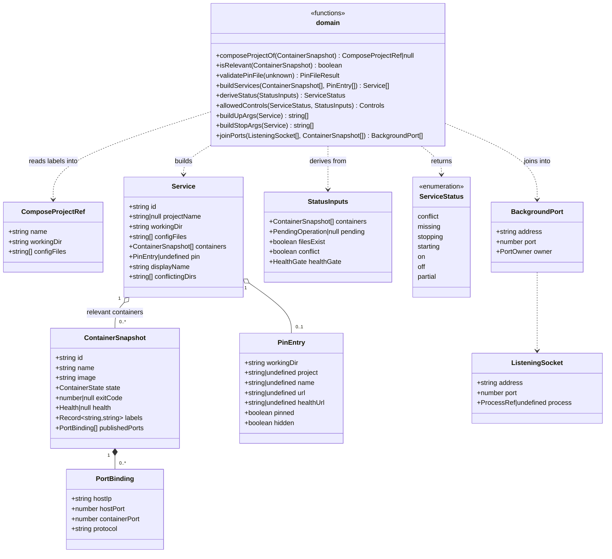

# Class diagram — launcher — pure domain types and functions

> **Source specs**: `docs/architecture/specs/v1-spec.md` §3, §4, §6, §8
> **Related ADRs**: ADR-0002, ADR-0003

## Context

Types and pure functions of `src/main/domain` (component `domain` in `03-component.md`).
Everything here is data in, data out: no Electron, no dockerode, no Node IO. Adapters
(next PR) translate Docker / `ss` / YAML into these input types; ServiceController feeds
them back in on every change. Does not cover adapters, IPC or UI.

## Diagram

## Notes

- Literal unions, not classes: `ContainerState` = Docker `State.Status`
  (`created | running | paused | restarting | removing | exited | dead`); `Health` =
  `starting | healthy | unhealthy`; `PendingOperation` = `start | stop`;
  `HealthGate` = `none | waiting | passed` (spec §3: `healthUrl` gate only when no container
  has a `HEALTHCHECK`); `PortOwner` = `process(name, pid) | container(name) | unknown`.
- **`Service.id`** = `workingDir` + `\0` + project name, or `workingDir` alone for a pin with
  no container yet (spec §3). `conflictingDirs` is non-empty iff the project name is seen
  with ≥ 2 working dirs (ADR-0003).
- **`deriveStatus`** implements the spec §4 precedence, `on` requiring ≥ 1 relevant
  container. `allowedControls` implements the §4 Start / Stop columns.
- **`filesExist`** is computed by the adapter (path check is IO) and passed in, keeping
  `deriveStatus` pure.
- **`buildUpArgs` / `buildStopArgs`** produce the R4 argument arrays (`--flag=value`,
  one `--file=` per config file, absolute paths only); for a pin with a `project` key and no
  container, `--project-name=<project>` is passed (review finding E).
- **`joinPorts`** de-duplicates IPv4 / IPv6 bindings of the same host port (observed on
  `sonarqube`: `0.0.0.0:9000` and `[::]:9000`).
- Parsing `ss` text and Docker API objects stays in the adapters; the domain only sees the
  typed snapshots above.
