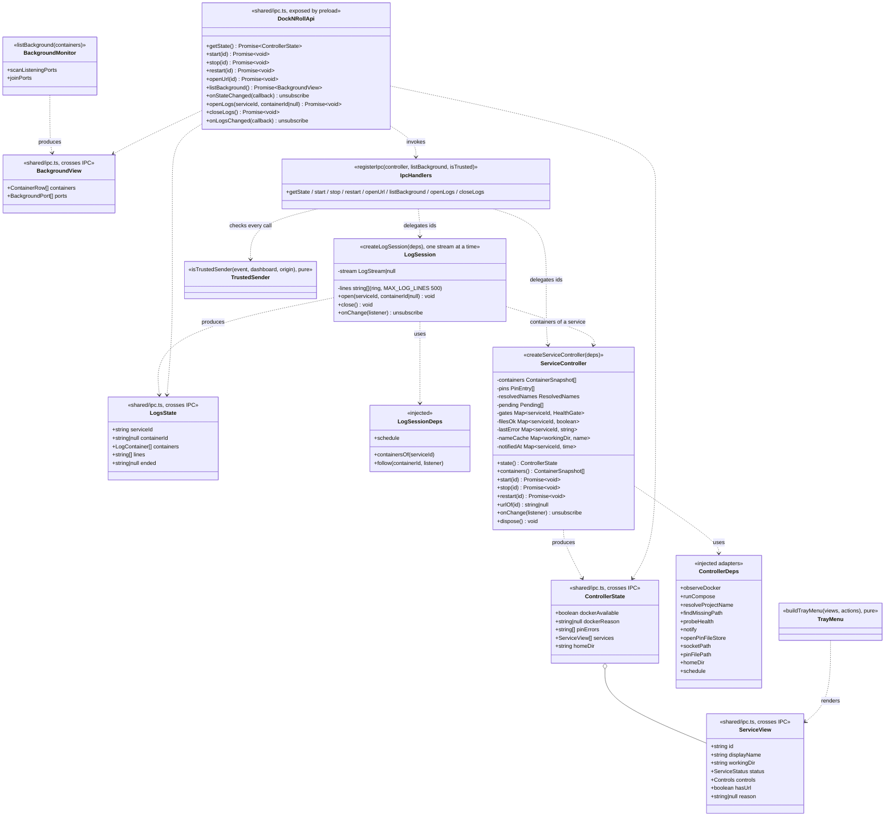

# Class diagram — launcher — controller, IPC contract and tray menu

> **Source specs**: `docs/architecture/specs/v1-spec.md` §3, §4, §5 UC1–UC5, §6 R4/R6
> **Related ADRs**: ADR-0002, ADR-0003, ADR-0005

## Context

The main-process application layer that wires the pure domain (`05-class-domain.md`) to the
adapters (`03-component.md`) and exposes it to the renderer and the tray. Does not cover the
dashboard UI (PR #7) or packaging (PR #9).

## Diagram

## Notes

- **One way in, one way out.** Every input (Docker snapshot, pin file, resolved names, file
  probes, health probes, pending operations) updates controller state and triggers one
  pure recomputation: `buildServices` → `deriveStatus` → `allowedControls` → `ServiceView[]`,
  then `onChange` listeners (IPC push `dock-n-roll:state-changed`, tray menu rebuild).
  `ControllerState` also carries Docker availability and pin-file errors (spec §4 banner).
  `createServiceController` resolves before the first recomputation: the first full state is an
  `onChange` (diagram 11).
- **A pending operation is keyed by working dir + the project name it runs under**, not by
  `Service.id` (which changes when a never-started pin gets its first container). A row with no
  project name yet matches any pending entry of its dir; other projects of the same dir stay
  independent. The check runs synchronously right before the entry is added, so two clicks in
  one tick run one command.
- **Name resolution failures are retried after 30 s** (checked before each recomputation), so a
  slow daemon at boot does not refuse Start until the app restarts.
- **Controls are off while Docker is unavailable** (and before the first snapshot), and Start
  is off for a never-started pin whose Compose name could not be resolved; a resolved one is
  always started under `--project-name=<resolved>`.
- **State is published only when it changes**: each push rebuilds the tray menu over D-Bus,
  which would otherwise close an open menu every 2 s during a health wait.
- Labels from Docker, pins and stderr are made menu-safe (`menuLabel`: `&` doubled, newlines
  flattened, 80 chars). `listBackground` shares one `ss` scan and caches it for 1 s.
- **The renderer only sends ids.** `start` / `stop` / `openUrl` look the id up in the current
  views; an unknown id, or a control the derived status forbids, is refused in the main
  process (spec §4 columns enforced on both sides). URLs never come from the renderer
  (spec R6): `openUrl(id)` opens the pin's validated `http`/`https` URL.
- **Trusted sender**: every handler first checks `isTrustedSender` — top frame of the dashboard
  window's own `webContents`, URL equal to the bundled `index.html` (prefix of the dev server
  URL in development). Pure function of the event, the dashboard and the expected origin, so it
  is unit-tested without Electron; `index.ts` only supplies the live values.
- **`reason`** carries what the row must explain: `invalidReason`, the conflicting dirs, a
  missing folder, or the stderr excerpt of the last failed command (spec UC1-4a, UC2-3a).
- **Name resolution (spec §10 P1)**: `resolveProjectName` runs only for pin dirs (without
  `project`) not resolved yet (failures retried after 30 s), outside the serialized chain and
  one batch at a time, so a slow `docker compose config` never holds another input; its result
  lands through a new recomputation. Names of removed pins are dropped.
- **Health gate (spec §3)**: while a service's containers all run or are done and its pin has a
  `healthUrl` with no container HEALTHCHECK, the controller probes it every 2 s
  (`schedule`); the gate becomes `passed` on the first 2xx/3xx and resets when the service
  stops.
- **Files**: `findMissingPath` is probed for every service on each snapshot or pin change (a few
  `stat` calls); it feeds `StatusInputs.filesExist` and names the missing folder or compose file
  in the reason.
- **`socketPath`** is one value given both to `observeDocker` and to `runCompose` (ADR-0002),
  resolved once at startup: a unix `DOCKER_HOST` (rootless Docker) wins, else
  `/var/run/docker.sock` (`dockerSocketPath`).
- The pin file lives at `~/.config/dock-n-roll/services.yaml`, which is also Electron's data
  directory for the app (Chromium caches sit beside it).
- Factory functions with injected dependencies, no classes: the controller is unit-tested
  with in-memory fakes of the adapters (the adapters themselves are already tested against
  their real boundaries). `src/main/index.ts` stays the composition root.
- **Logs (UC7, diagram 14)**: `LogSession` follows one container of a listed service, chosen
  from `ServiceController` views (a container id from the renderer is used only if it belongs
  to that service). Lines are cleaned and capped in the main process; `logsChanged` pushes the
  full `LogsState` at most every 200 ms. The stream closes on `closeLogs`, a new `openLogs`,
  the dashboard hiding or reloading, and quit.
- `ContainerRow` = name, image, state, health, Compose project (UC4); built from the snapshot.
