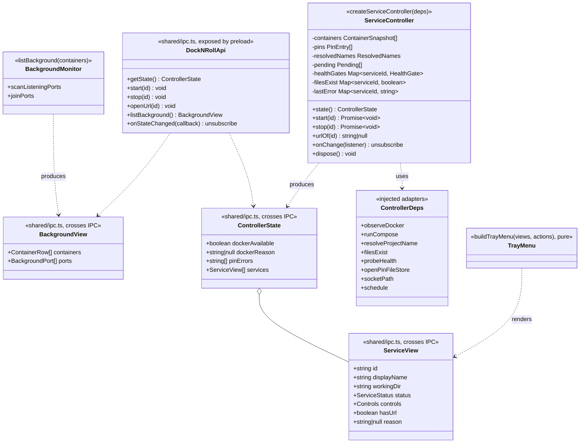

# Class diagram — launcher — controller, IPC contract and tray menu

> **Source specs**: `docs/architecture/specs/v1-spec.md` §3, §4, §5 UC1–UC5, §6 R4/R6
> **Related ADRs**: ADR-0002, ADR-0003, ADR-0005

## Context

The main-process application layer that wires the pure domain (`05-class-domain.md`) to the
adapters (`03-component.md`) and exposes it to the renderer and the tray. Does not cover the
dashboard UI (PR 6) or packaging (PR 7).

## Diagram

## Notes

- **One way in, one way out.** Every input (Docker snapshot, pin file, resolved names, file
  probes, health probes, pending operations) updates controller state and triggers one
  pure recomputation: `buildServices` → `deriveStatus` → `allowedControls` → `ServiceView[]`,
  then `onChange` listeners (IPC push `dock-n-roll:state-changed`, tray menu rebuild).
  `ControllerState` also carries Docker availability and pin-file errors (spec §4 banner).
- **A pending operation is keyed by `workingDir` + `projectName`, not by `Service.id`.** For a
  never-started pin without `project`, `projectName` is null and matches every project of that
  dir: the project name (and the id) only appear with the first container, while `up --wait`
  is still running — so Start stays disabled across that change.
- **The renderer only sends ids.** `start` / `stop` / `openUrl` look the id up in the current
  views; an unknown id, or a control the derived status forbids, is refused in the main
  process (spec §4 columns enforced on both sides). URLs never come from the renderer
  (spec R6): `openUrl(id)` opens the pin's validated `http`/`https` URL.
- **`reason`** carries what the row must explain: `invalidReason`, the conflicting dirs, a
  missing folder, or the stderr excerpt of the last failed command (spec UC1-4a, UC2-3a).
- **Name resolution (spec §10 P1)**: on every pin-file change, `resolveProjectName` runs for
  each pin without `project`; results replace `resolvedNames`.
- **Health gate (spec §3)**: while a service's containers all run or are done and its pin has a
  `healthUrl` with no container HEALTHCHECK, the controller probes it every 2 s
  (`schedule`); the gate becomes `passed` on the first 2xx/3xx and resets when the service
  stops.
- **Files**: `filesExist` is probed for every service on each snapshot or pin change (a few
  `stat` calls); results feed `StatusInputs.filesExist`.
- **`socketPath`** is one value given both to `observeDocker` and to `runCompose` (ADR-0002),
  resolved once at startup: a unix `DOCKER_HOST` (rootless Docker) wins, else
  `/var/run/docker.sock` (`dockerSocketPath`).
- The pin file lives at `~/.config/dock-n-roll/services.yaml`, which is also Electron's data
  directory for the app (Chromium caches sit beside it).
- Factory functions with injected dependencies, no classes: the controller is unit-tested
  with in-memory fakes of the adapters (the adapters themselves are already tested against
  their real boundaries). `src/main/index.ts` stays the composition root.
- `ContainerRow` = name, image, state, health, Compose project (UC4); built from the snapshot.
