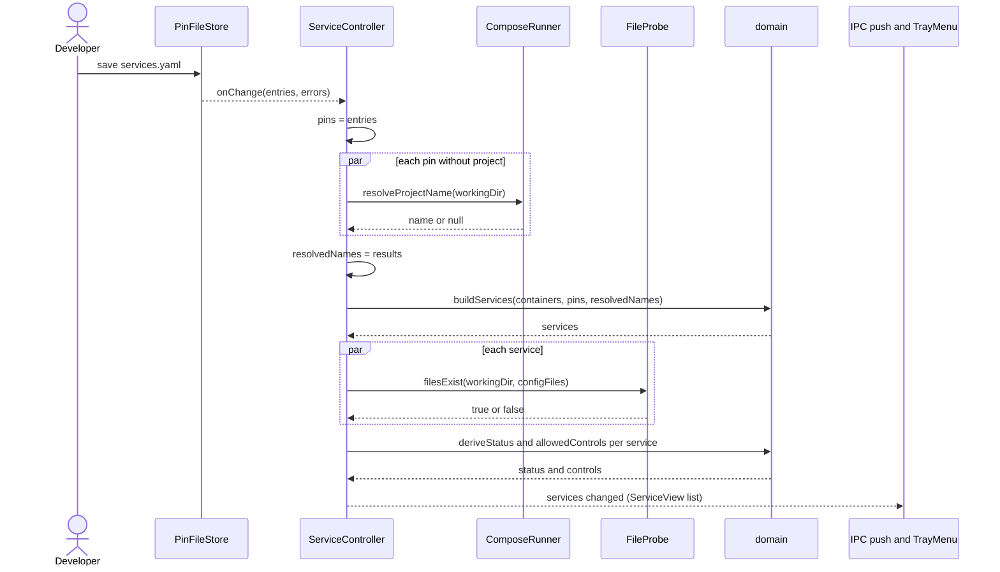

# Sequence diagram — launcher — pin file changed

> **Source specs**: `docs/architecture/specs/v1-spec.md` §3, §9 Q1, §10 P1
> **Related ADRs**: ADR-0002, ADR-0003, ADR-0005

## Context

The one recomputation path that involves several async inputs: the owner edits
`services.yaml`, names are re-resolved, files re-probed, then views are pushed. Docker
snapshots follow the same tail (from "recompute") without the resolution step.

## Diagram

## Notes

- Recomputations are serialized and each one reads the latest inputs when it starts: results
  publish in order, so an older recomputation can never publish after a newer one. Only names
  of pin dirs not resolved yet are fetched.
- Pin-file errors are shown (dashboard banner) but never clear the last valid pins — that is
  `PinFileStore`'s contract.
