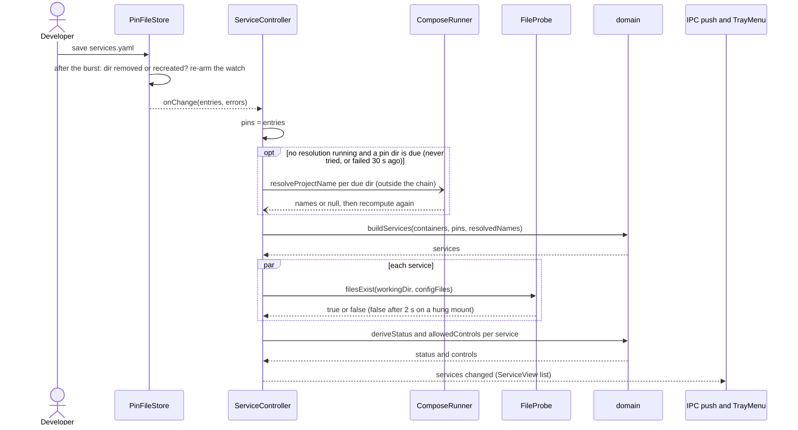

# Sequence diagram — launcher — pin file changed

> **Source specs**: `docs/architecture/specs/v1-spec.md` §3, §9 Q1, §10 P1
> **Related ADRs**: ADR-0002, ADR-0003, ADR-0005

## Context

The one recomputation path that involves several async inputs: the owner edits
`services.yaml`, files are re-probed and views pushed at once; names of new pins resolve in the
background and land through a second recomputation. Docker snapshots follow the same tail.

## Diagram

## Notes

- Recomputations are serialized and each one reads the latest inputs when it starts: results
  publish in order, so an older recomputation can never publish after a newer one.
- Name resolution (`docker compose config`, up to 20 s) runs **outside** the chain, one at a
  time: a slow or failing dir never delays a snapshot or a pin change. Until it ends the row is
  unresolved and Start stays refused. Only dirs not resolved yet are fetched.
- `PinFileStore` keeps exactly one live watcher. After each burst it re-arms when the directory
  reported its own removal or its inode changed (a recreated directory may reuse the inode
  number). Its `mkdir`, `stat` and reads time out after 5 s.
- Pin-file errors are shown (dashboard banner) but never clear the last valid pins — that is
  `PinFileStore`'s contract.
