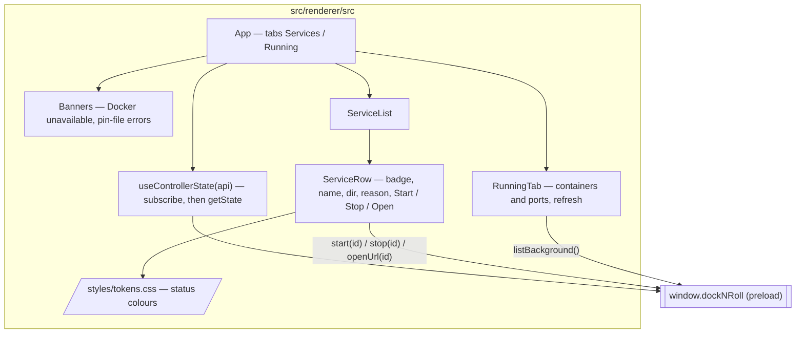

# Component diagram — launcher — dashboard window (renderer)

> **Source specs**: `docs/architecture/specs/v1-spec.md` §4 (statuses, colours, banner), UC1–UC5
> **Related ADRs**: ADR-0004 (React + CSS design tokens)
> **Contract**: `src/shared/ipc.ts` (`DockNRollApi`, `ControllerState`, `BackgroundView`), class diagram 07

## Context

The React page shown in the dashboard window. It only renders what the main process pushes
and sends ids back: every rule (statuses, allowed controls, reasons) is already decided by
the controller. Does not cover the tray menu (07) or packaging (PR 7).

## Diagram



## Wireframe

```text
┌ dock-n-roll ─────────────────────────────────────────────────┐
│ [ Services ]  [ Running ]                                     │
│ ⚠ Docker unavailable: connect ENOENT /var/run/docker.sock     │  ← banner, only when down
│ ⚠ services.yaml: bad indentation at line 3                    │  ← banner, pin-file errors
│                                                               │
│ ● projet-ind-2-inscription   ~/…/docker-mysql      [Stop]     │  green
│ ● happihub-docker-audit      ~/…/happihub          [Start]    │  red
│ ● SonarQube                  ~/…/sonarqube-stack   (greyed)   │  grey
│     project name also used by ~/…/dev-infra/sonarqube         │  ← reason line
│ ● Blog                       ~/…/blog   [Stop] [Open ↗]       │  orange while starting
└───────────────────────────────────────────────────────────────┘
```

## Notes

- **`useControllerState`** subscribes with `onStateChanged` **before** calling `getState`
  (contract of `DockNRollApi`), keeps the latest state, and unsubscribes on unmount.
- **Buttons mirror `controls`** exactly; the main process re-checks anyway. A clicked button
  shows no optimistic state: the next pushed state (orange `starting`) is the feedback.
- **Badge = status colour token** (`--status-on`, `--status-off`, `--status-transitional`,
  `--status-unavailable`, spec §4), plus the status word for screen readers and colour-blind
  users — colour is never the only signal.
- **Running tab** calls `listBackground()` when opened and on a Refresh button (the main
  process caches it for 1 s); no polling.
- **Accessibility**: buttons are real `<button>`s with the service name in their accessible
  label ("Start Blog"); the banner region is `role="alert"`.
- Text from Docker and the pin file is rendered as React text (escaped), never as HTML.
