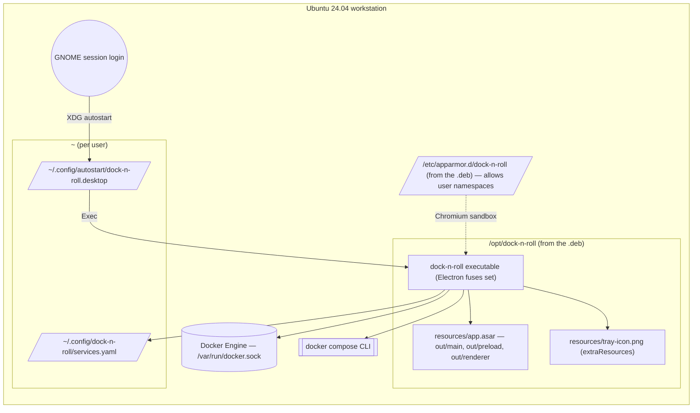

# Deployment diagram — launcher — installed app on the workstation

> **Source specs**: `docs/architecture/specs/v1-spec.md` AC1, §2
> **Related ADRs**: ADR-0001, ADR-0006

## Context

Where the packaged app lives and what it touches at runtime once installed from the `.deb`.

## Diagram

## Notes

- The autostart entry is written by the app ("Start at login" in the tray menu), never by the
  package: it is a per-user choice.
- Packaged builds resolve the tray icon from `process.resourcesPath`; the preload script is read
  from inside `app.asar`, which the sandboxed renderer supports.
