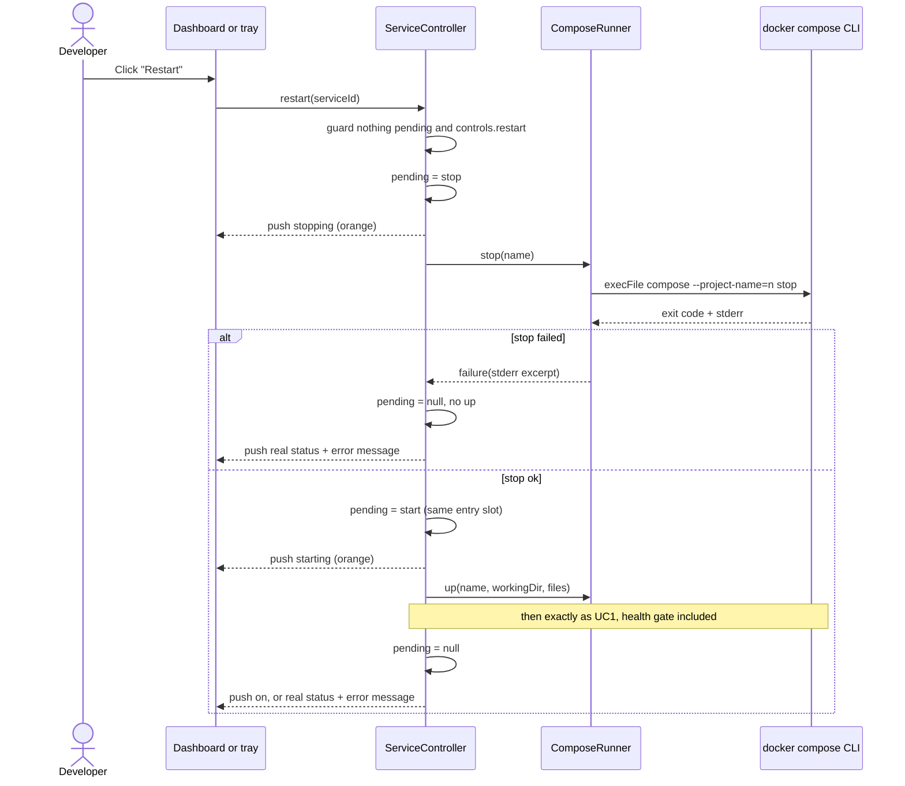

# Sequence diagram — launcher — restart a service

> **Source specs**: `docs/architecture/specs/v1-spec.md` §4, §5 UC1, UC2; UC6 (v1.1)
> **Related ADRs**: ADR-0002, ADR-0003

## Context

UC6: the developer restarts a running service, usually after editing its Compose file or
`.env`. `docker compose restart` would keep the old container config, so the restart is the
stop of UC2 followed by the `up` of UC1 (`02-sequence-start-service.md`), under one pending
entry so no other command can slip in between.

## Diagram

## Notes

- The pending entry is swapped, never removed, between the two commands: a click or an event
  arriving between `stop` and `up` sees the service busy.
- Like a plain Start, no `up` once the daemon is gone or the folder / a Compose file is
  missing: the row shows that reason instead.
- A failed `stop` skips the `up`: starting over a half-stopped stack would hide the error.
