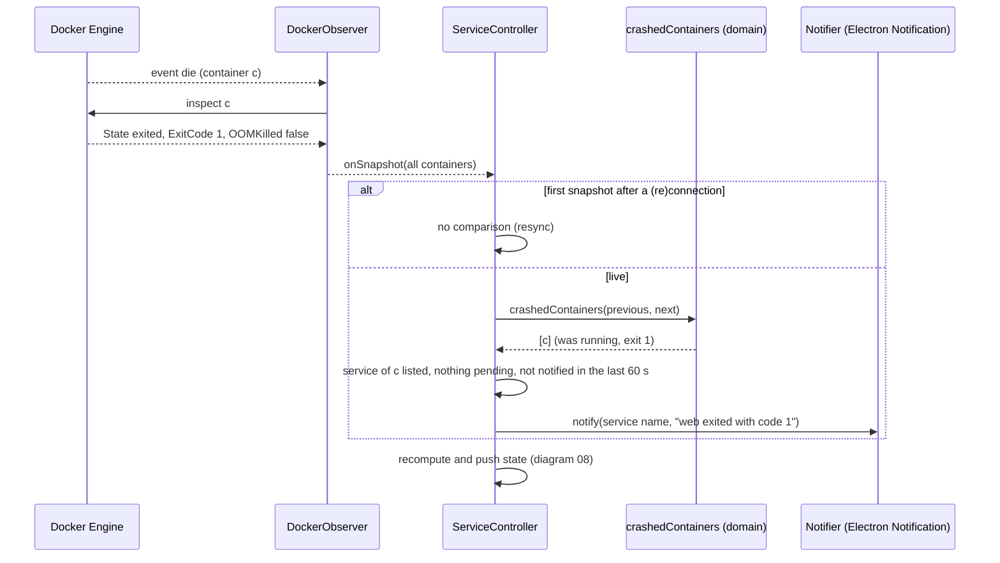

# Sequence diagram — launcher — crash notification

> **Source specs**: `docs/architecture/specs/v1-spec.md` §5 UC3 extension 3b (v1.1)
> **Related ADRs**: ADR-0002, ADR-0005

## Context

A container of a listed service dies on its own, while the developer is elsewhere. The tray
colour changes, but nobody watches it: the system shows a desktop notification. It reuses the
snapshot flow of diagram 06 — no new Docker call, the decision is a pure comparison of the
previous and the new snapshot.

## Diagram

## Notes

- **Crash rule** (owner MCDA A): `running` → `restarting` or `dead`, or → `exited` with
  `OOMKilled` or an exit code outside {0, 130, 137, 143}. Signal exits are what `docker stop`
  and Ctrl-C produce from a terminal: notifying them would alert on every intentional stop.
  Missed on purpose: a non-OOM `kill -9` from the host, a SIGTERM from inside the container.
- **No notification** for a service with a pending operation (its Stop, or the stop step of a
  Restart), in the 10 s after its Stop ended (late `die` of apps exiting 1 on SIGTERM), for containers outside the listed services (hidden, one-off, non-Compose), or on
  the first snapshot after Docker came back (the gap is unknown, not a crash).
- **Rate limit**: one per service per 60 s, so a crash loop does not flood the desktop.
- A container that crashes and restarts between two inspects may be seen running both
  times: best effort, the event-driven snapshot is not a full history.
- The notification text is escaped: GNOME reads a subset of markup in the body.
