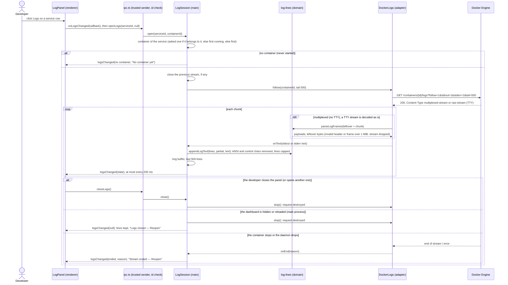

# Sequence diagram — launcher — read a service's logs

> **Source specs**: `docs/architecture/specs/v1-spec.md` §5 UC7 (v1.1)
> **Related ADRs**: ADR-0005, ADR-0008

## Context

The developer opens the Logs panel of a service row in the dashboard to see why it failed or
what it is doing. The main process follows the logs of one container over the Docker socket
(ADR-0008) and pushes the last lines to the dashboard. One panel, so one stream, at a time.
Does not cover the tray (no logs there) or the Running tab.

## Diagram

## Notes

- **Only ids cross IPC**: the renderer names a service id and, optionally, one of that
  service's container ids. Any other container id is ignored, so the dashboard cannot read the
  logs of a container outside the listed services.
- **Text only**: lines are rendered with `textContent` in a `<pre>`, never as HTML. ANSI
  escapes and control characters (except tab) are removed in the main process; a line is cut
  at 2000 characters, the buffer keeps 500 lines.
- **Frames**: without a TTY, Docker multiplexes stdout and stderr in frames (8-byte header:
  stream, 3 zero bytes, big-endian payload size). A frame can be split across chunks, so the
  parser returns the leftover bytes. With a TTY the stream is raw text. Docker tells which by
  the response `Content-Type` (API ≥ 1.42).
- **No reconnect**: when the container stops (Stop, Restart, crash) the stream ends and the
  panel offers Reopen, also after "No container yet" (a reopen picks the container started since). Following across restarts is backlog (YAGNI).
- **Push throttled** to one state every 200 ms, full state (like `stateChanged`), so a
  missed push loses nothing and a chatty container cannot flood IPC.
- **Lifecycle**: the stream is destroyed on `closeLogs`, on a new `openLogs`, when the
  dashboard window hides (closing it only hides it) or reloads, and on quit. A `null` push
  ends an open panel ("Logs closed", Reopen); a panel ignores it before its first state, as it
  is then the close of the panel it replaces.
- **Bounded parsing**: a frame header that is not Docker's (stream byte above 2, non-zero
  padding) or declares more than 1 MiB drops the stream ("Unreadable log stream") instead of
  buffering; a line is cut before cleaning, so the work per line is bounded too.
