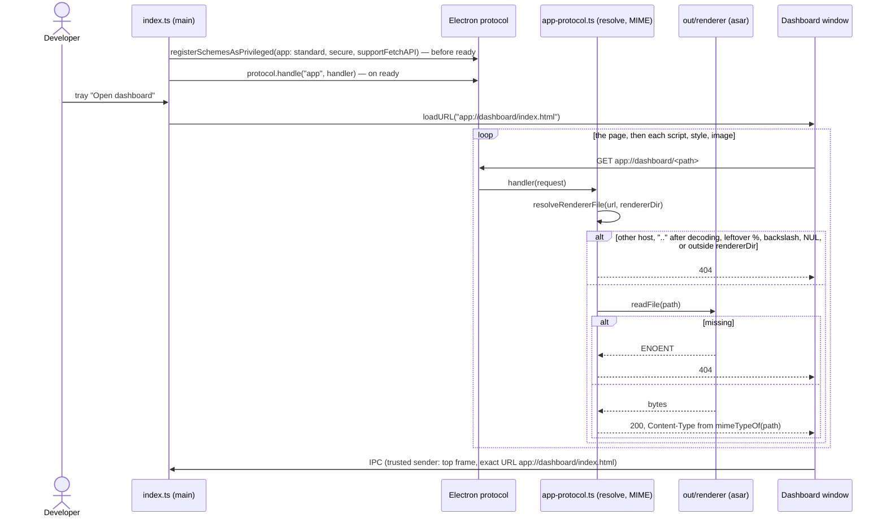

# Sequence diagram — launcher — load the dashboard page

> **Source specs**: issue #19 (turn off the `grantFileProtocolExtraPrivileges` fuse)
> **Related ADRs**: ADR-0006 (packaging, fuses), ADR-0009 (custom `app://` protocol)

## Context

The installed app serves the dashboard page from a privileged custom scheme instead of
`loadFile()`, so the `file:` protocol keeps no extra privileges. The developer opens the
dashboard from the tray; the window loads `app://dashboard/index.html` and every asset it
references through the same handler. Does not cover the dev server (`pnpm dev` keeps
`loadURL(ELECTRON_RENDERER_URL)`) or IPC once loaded (diagram 11).

## Diagram

## Notes

- **Origin**: `app` is registered `standard` and `secure`, so `app://dashboard` is a real
  origin; the page CSP `default-src 'self'` covers its own assets unchanged.
- **Confinement**: the URL parser already collapses literal and `%2e` dot segments; the path is
  then decoded once and refused if it holds a leftover `%` (double encoding), `\`, NUL, or an
  empty, `.` or `..` segment; the normalised result must stay under `rendererDir`. `/` serves
  `index.html`. Only the host `dashboard` (no port) is accepted.
- **Errors**: a missing file is a 404; any other read error is logged, then a 404.
- **MIME**: a closed table (`html`, `js`, `css`, `svg`, `png`, `ico`, `woff2`, `json`);
  any other extension is `application/octet-stream`.
- **Fuse**: with the custom scheme in place, `grantFileProtocolExtraPrivileges` is off in
  `electron-builder.yml`.
