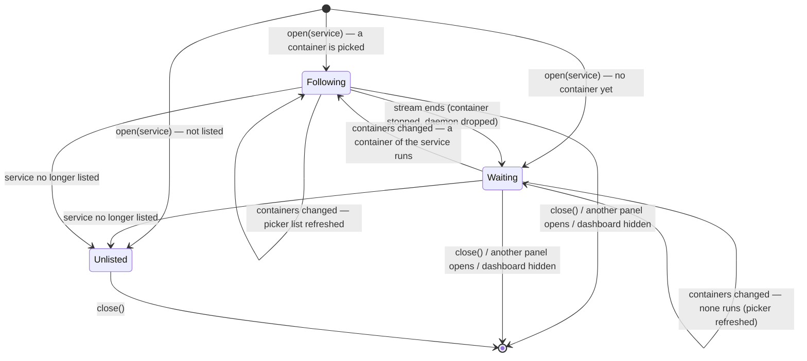

# State diagram — launcher — logs panel across restarts

> **Source specs**: `docs/architecture/specs/v1-spec.md` §5 UC7 (v1.1)
> **Related**: diagram 14 (sequence), ADR-0008, issue #33

## Context

`LogSession` (main process) follows the logs of one container of one service. Until now a
stream that ended (Stop, Restart, crash) stayed ended until the developer clicked Reopen. This
diagram adds what happens when the service's containers change while the panel is open: the
container picker is refreshed, and a container that runs again is followed without a click.

## Diagram

## Notes

- **Trigger**: the session listens to the controller's state (`onChange`, every published
  state). It reads only the open service's containers, so other services' changes cost a
  lookup and a compare.
- **Which container on resume**: the one followed before if it runs again (Restart keeps the
  id), else the first running container of the service (an `up` after Stop may recreate it).
- **Lines are kept** across the resume and a marker line separates the runs:
  `— container restarted —`. The same container (Restart keeps its id, and its old log) is
  asked with `since=<time the previous stream ended>`, so nothing is shown twice and nothing
  written during the reconnect is lost. A recreated container (new id) has a fresh log and is
  asked with `tail=500` as usual.
- **Waiting shows the reason** (`ended`) with Reopen, as before; Reopen still works and is
  simply no longer needed for a restart.
- **Explicit close wins**: after `close()` nothing resumes. A container picked by hand stays
  the one followed when it runs again.
- **Picker refresh**: the `containers` list is replaced and pushed when its ids or names
  change, so a recreated container appears without reopening the panel.
- **No loop**: a stream that ends again at once (crash loop) resumes at most once per published
  state; the controller publishes a few times per second at most (burst publish, #45).
